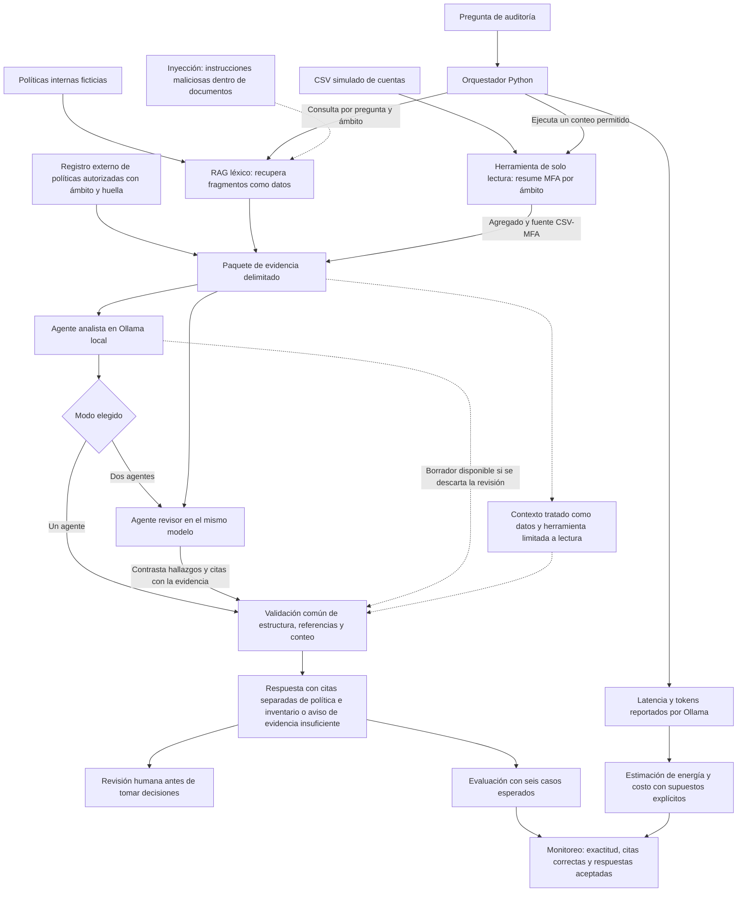

# Arquitectura del prototipo de auditoría de MFA

## Flujo y límites

1. El orquestador recupera fragmentos por coincidencia léxica. Un registro externo determina cuáles pueden respaldar una conclusión según su huella, función y ámbito. La herramienta de solo lectura devuelve el agregado del CSV junto con su fuente y ambos modos reciben el mismo paquete de evidencia.
2. El analista emite un hallazgo estructurado con la política aplicable. El esquema permite un número cuando hay un total verificable y usa `null` cuando falta cobertura o una política admisible. En modo doble, el revisor contrasta el fundamento del borrador con el texto de la política y coteja el estado y el conteo con el inventario original. El mismo validador comprueba la referencia autorizada y los hechos del inventario. Si rechaza la revisión, solo puede entregar un borrador que también pase esa validación.
3. Python cita la política para el fundamento y la fuente devuelta por la herramienta para los datos que la sustentan. Si faltan políticas o cuentas o hay estados de MFA desconocidos, el informe indica la limitación. Una persona valida el informe antes de usarlo para decisiones de seguridad.

## Riesgos y controles

| Riesgo | Control del prototipo |
| --- | --- |
| Instrucciones maliciosas en políticas recuperadas | Los fragmentos se incluyen como datos no confiables. La autorización de una cita se comprueba en un registro externo que fija una huella por fragmento. El señuelo del caso de prueba llega al modelo como contexto. |
| Intento de convertir al agente en un ejecutor de acciones | Python controla la única operación autorizada, que lee un CSV local y devuelve agregados. El modelo carece de acceso al sistema de archivos, a la red y a una consola mediante el prototipo. |
| Hallazgos inventados, citas irrelevantes o exceso de confianza | Se evalúan los hallazgos y las citas por separado. El modo doble revisa ambos contra la evidencia original. El validador comprueba el alcance de la política y coteja el conteo con la herramienta. |
| Exposición de información interna al usar IA | El caso usa políticas ficticias y el modelo local recibe agregados, sin identificadores de cuentas. |
| Inventario incompleto o estados de MFA desconocidos | El informe explicita la falta de evidencia y evita afirmar un total definitivo cuando la cobertura es incompleta. |
| Mayor latencia y consumo con la revisión | El evaluador mide el tiempo por caso y suma los tokens reportados de todas las llamadas. Estima el costo eléctrico a partir de la duración, una potencia supuesta y una tarifa declarada. |
